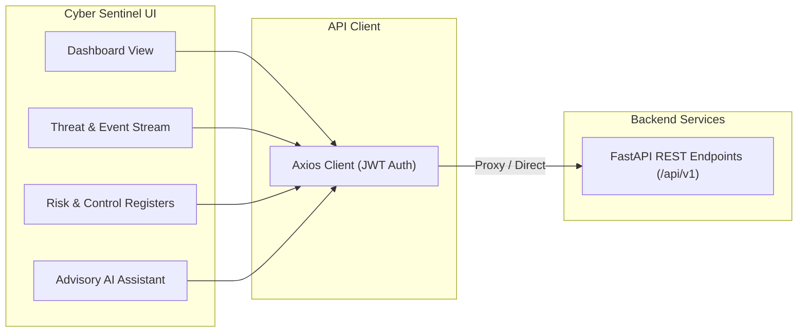

# Cyber Sentinel — Frontend Dashboard


Modern SOC & GRC monitoring dashboard for **Cyber Sentinel**. Provides real-time views of honeypot telemetry, deterministic threat detections, automated risk registers, and compliance gap assessments.

---

## Architecture & Data Flow



---

## Setup & Running

```bash
# Clone the repository
git clone https://github.com/Abhi-Sharma-07/Cyber-Sentinel-Frontend.git
cd Cyber-Sentinel-Frontend

# Install dependencies
npm install

# Configure environment
cp .env.example .env

# Start development server
npm run dev
```

---

## Author & Attribution

**Cyber Sentinel Frontend** is designed and developed by **Abhi Sharma**.  
All rights reserved.
